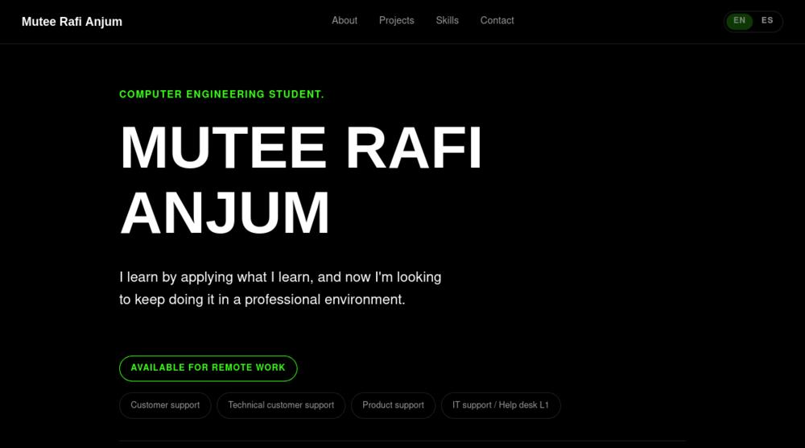
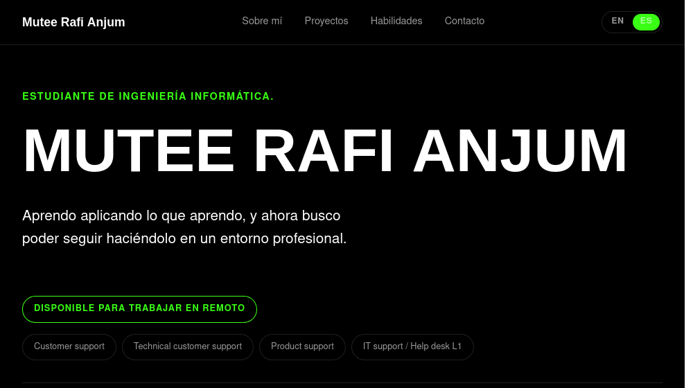
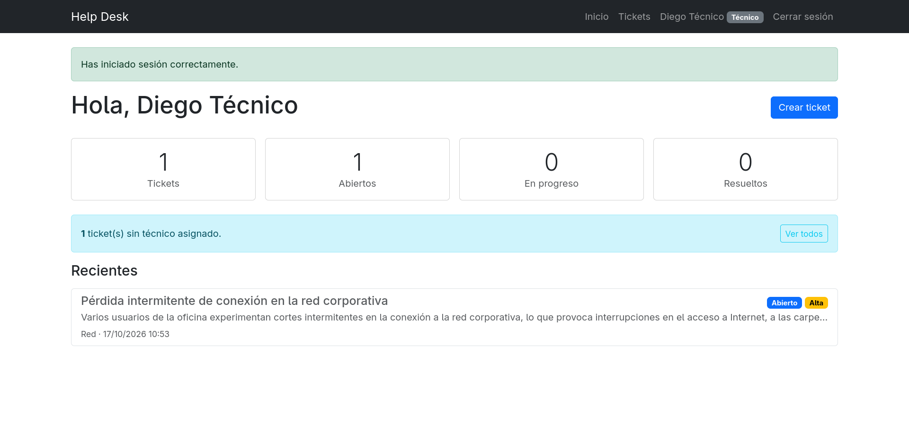

<div align="center">

# Mutee Rafi Anjum - Portfolio

**Personal website, a single-page portfolio, no frameworks and no build step.**

[](https://muty-gif.github.io/Portfolio-Mutee/)
[](https://developer.mozilla.org/docs/Web/HTML)
[](https://developer.mozilla.org/docs/Web/CSS)
[](https://developer.mozilla.org/docs/Web/JavaScript)
[](https://pages.github.com/)

**English** | [Español](README.es.md)

</div>

## Preview

| English | Español |
| :---: | :---: |
|  |  |

## About this site

This is my personal portfolio; a fast, dependency-free static site that presents who I am, what I'm learning and the projects I build while studying computer engineering. It is fully bilingual, so visitors can read it in English or Spanish with a single click.

**[→ See the live site](https://muty-gif.github.io/Portfolio-Mutee/)**

## Features

- **Bilingual (EN / ES)**: a language switch in the header, with browser-language detection on first visit and the choice remembered for the next one.
- **Responsive**: works from small phones up to wide desktop screens.
- **Accessible**: semantic HTML, keyboard navigation, visible focus states and `prefers-reduced-motion` support.
- **Lightweight**: plain HTML, CSS and vanilla JavaScript. No dependencies, no build step, loads in a blink.
- **SEO & social ready**: meta description, Open Graph tags and a custom favicon.

## Tech stack

| Layer | Technology |
| --- | --- |
| Structure | HTML5 |
| Styles | CSS3 (custom properties, Flexbox, media queries) |
| Behaviour | Vanilla JavaScript (i18n switcher) |
| Hosting | GitHub Pages |

## Featured projects

### [Ticketing system (Help Desk)](https://github.com/muty-gif/Help-Desk-L1)

A Flask-based support web application. Users report issues and the technical team manages their status, priority and assignment, with comments, change history and search filters. Covered by 51 automated tests with pytest.



### [Project and task tracker (TrackIt)](https://github.com/muty-gif/TrackIt)

A project and task tracker built with Flask and a JSON REST API, with a plain HTML, CSS and JavaScript front end that talks to it using `fetch()`. Each user only ever sees their own projects and tasks, and other users' data returns `404` so it is never leaked. Covered by 57 automated tests, including cross-user isolation.


## Project structure

```text
Portfolio-Mutee/
├── index.html    # Page structure and content (English is the default text)
├── styles.css    # Dark neon theme, responsive layout, accessibility details
├── script.js     # Language switcher + the EN/ES translation dictionary
└── images/       # Favicon, project screenshots and README previews
```

## Run it locally

```bash
git clone https://github.com/muty-gif/Portfolio-Mutee.git
cd Portfolio-Mutee
python3 -m http.server 8000
```

Then open [http://localhost:8000](http://localhost:8000). Opening `index.html` directly in a browser works too.

> **Editing content:** every translatable string lives in `script.js`, under the `en` and `es` dictionaries. Change a text in both languages and you are done, the page picks it up on load.

## Deployment

The site is published with [GitHub Pages](https://pages.github.com/). Any push to the `main` branch is rebuilt and deployed automatically.

## Contact

Feel free to reach out:

- Email: [muteerafi@gmail.com](mailto:muteerafi@gmail.com)
- GitHub: [github.com/muty-gif](https://github.com/muty-gif/)
- LinkedIn: [Mutee Rafi Anjum](https://www.linkedin.com/in/mutee-rafi-anjum-52b99142b/)

<div align="center">
<sub>© 2026 Mutee Rafi Anjum. All rights reserved.</sub>
</div>
